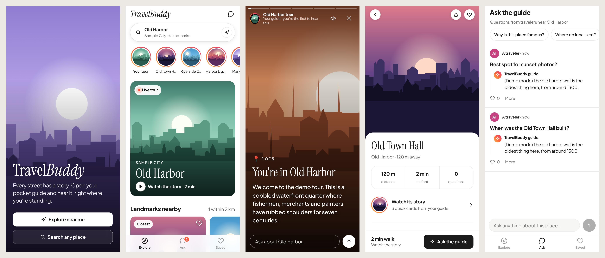

# TravelBuddy

A pocket food guide for your phone. Open it anywhere and it tells you the food story of the neighborhood you're standing in (what it eats, why, and the one bite not to miss) as a few swipeable story cards, lists the best places to eat around you, each with its own short story (why people come, what to order, a tip), and answers food questions. Every Q&A is saved and shown to other people within about 1.5 km.



It installs to the home screen like an app (full screen, its own icon): on iPhone open it in Safari, tap Share, then "Add to Home Screen"; on Android Chrome offers "Install app".

## Run it

Needs Node.js 22.13 or newer.

```bash
npm install
export ANTHROPIC_API_KEY=sk-ant-...   # from console.anthropic.com
npm start                            # http://localhost:3000
```

No key yet? `npm run demo` runs the full app with placeholder narration.

To try it on your phone, the page must be served over HTTPS (browsers only share location with `localhost` or HTTPS). The quickest way is a tunnel such as `npx localtunnel --port 3000` or `cloudflared tunnel --url http://localhost:3000`, then open the HTTPS link on your phone.

## Deploy it

The repo includes a Render Blueprint (`render.yaml`):

1. Push this folder to a GitHub repo.
2. In [Render](https://render.com), choose **New > Blueprint** and pick the repo.
3. Fill in `ANTHROPIC_API_KEY` and `CONTACT_EMAIL` when asked, then create it.

Render builds it, gives you an `https://….onrender.com` link (HTTPS, so location works on phones), and keeps the database on a 1 GB disk. The Starter plan plus the disk is about $7.25 a month, plus your Claude API usage. Pushing to the repo redeploys.

**Railway:** New Project › Deploy from GitHub repo, pick this repo. Railway builds the `Dockerfile` and uses `railway.json` for the health check. Then right-click the service › **Attach volume** with mount path `/data`, add the variables `ANTHROPIC_API_KEY` and `CONTACT_EMAIL`, and under Settings › Networking click **Generate Domain**.

For other container hosts (Fly.io, Cloud Run), use the `Dockerfile` and mount a volume at `/data` so stories and questions survive restarts.

## How it works

| Piece | What it does |
|---|---|
| `public/` | The phone app, styled like Instagram meets Airbnb. **Explore**: a pill search bar, a row of story circles (your area's tour plus one per landmark), a big photo card that plays the tour, a rail of landmark cards with save hearts, and a preview of travelers' questions. **Stories**: full-screen cards with progress bars; tap right or left to move, hold to pause, swipe down to close, optional read-aloud, and an "Ask about this…" reply box. **Landmark page**: full-bleed photo, quick stats, its own 3-card story, directions, related questions, and a sticky "Ask the guide" bar. **Ask**: a comment-style feed with likes, quick-question chips and a composer. **Saved**: a wishlist grid of hearted landmarks. Self-hosted fonts (Plus Jakarta Sans, Instrument Serif), line icons, dark mode, reduced-motion support, generated postcard art when a landmark has no photo. Installable (manifest, icons, service worker). |
| `food.js` | Nearby places to eat within 1.5 km. With `GOOGLE_PLACES_API_KEY` set it uses Google Places (ratings, review counts, price, open now, photos through `/api/food-photo` so the key stays on the server); otherwise OpenStreetMap through Overpass (free, no ratings or photos). Ranked by quality and distance, chains pushed down, and kept varied (not ten coffee shops). |
| `places.js` | Coordinates → place name (OpenStreetMap Nominatim), the spots from `food.js`, plus restaurants, markets and bakeries famous enough for a Wikipedia article (badged "Famous"), and area photos from Wikimedia Commons. Cached per ~100 m. |
| `server.js` | `GET /api/tour` (and `GET /api/spot-story` for a single landmark) streams the guide's rundown from Claude as `## emoji Title` cards, grounded in the landmark notes; the app turns them into cards as they arrive. Answers are capped at about 70 words, leading with a one-line bold answer. `POST /api/ask` streams an answer and saves the Q&A (optionally tagged with the landmark it's about); a quick moderation check decides whether other travelers can see it. Spot stories are only written for real places to eat near the person and are stored by the spot's ID. `GET /api/questions` returns Q&As near a point. |
| Shared stories | Story cards are generated once and stored. The area tour is keyed by neighborhood (from OpenStreetMap, e.g. `osm:fr/paris/montmartre`), falling back to a ~1 km grid square; landmark stories are keyed by landmark. Everyone after the first traveler gets the stored cards instantly. If several people open the same area while it's still being written, they all watch the same stream and Claude is called once. Failed or refused generations aren't stored. Bump `STORY_VERSION` in `server.js` after changing the story prompts to regenerate everything. |
| `store.js` | SQLite (built into Node): a `questions` table with lat/lon for the nearby Q&A feed, and a `stories` table of generated cards with view counts. |

## Settings (environment variables)

| Variable | Default | Notes |
|---|---|---|
| `ANTHROPIC_API_KEY` | — | Required for real narration. |
| `CLAUDE_STORY_MODEL` | `claude-opus-5-5` | Writes the area tours and landmark stories. Each is paid once, then stored. (`CLAUDE_MODEL` still works as an older name for this.) |
| `CLAUDE_ANSWER_MODEL` | `claude-sonnet-5-5` | Answers follow-up questions, paid on every question. |
| `FOOD_CITY` | `florence` | `florence`: the app is a Florence guide built on a hand-picked list of 21 restaurants (`florence.js`), sorted by distance when you're in Florence and opened on the Duomo otherwise. Everything about each place is stored with the app, with no paid API: photos go in `public/img/florence/` (see its README). `anywhere`: nearby search wherever you are. |
| `GOOGLE_PLACES_API_KEY` | — | Optional, `FOOD_CITY=anywhere` only. Google Maps Platform key with the Places API (New) enabled. Adds ratings, prices, open-now and photos. Without it, places come from OpenStreetMap. The Florence guide doesn't use it. |
| `PLACES_DAILY_LIMIT` | `100` | Hard cap on paid Google Places calls per day (UTC), saved across restarts (`FOOD_CITY=anywhere` only). Past it, the app uses the free data until midnight. Today's count is in `/healthz`. |
| `FOOD_WEB_SEARCH` | on | Stories search the web first (what a spot is known for, what people order). Each stored story is paid once. `0` turns it off. |
| `OVERPASS_URL` | overpass-api.de | OpenStreetMap Overpass endpoint used when there's no Google key. |
| `CLAUDE_EFFORT` | `low` | `low`/`medium`/`high`; higher is slower and richer. |
| `ASK_PER_HOUR` | `20` | Questions one traveler can ask per hour. |
| `GENERATE_PER_HOUR` | `15` | New (not yet stored) stories one traveler can trigger per hour. Replaying stored stories is unlimited. |
| `MODERATION_MODEL` | `claude-haiku-5-5` | Checks each question before it's shown to others; flagged ones stay private to the asker. |
| `STORY_TTL_DAYS` | `0` | Regenerate stored stories older than this many days. `0` keeps them forever. |
| `PORT` | `3000` | |
| `TRUST_PROXY` | `loopback` | Set to `1` behind a host's proxy (Render, Fly, Railway) so rate limits see the real visitor. |
| `CONTACT_EMAIL` | — | Added to requests to OpenStreetMap, as their usage policy asks. |
| `DB_PATH` | `./travelbuddy.db` | Where Q&As are stored. |
| `MOCK=1` / `MOCK_PLACES=1` | off | Placeholder narration / placeholder landmarks for offline testing. |

## Known limits of this prototype

- No accounts yet: every question shows as "A traveler". Likes are limited to one per traveler, identified by a salted hash of their IP address, so people behind the same network share one like.
- Rate limits are kept in memory, so they reset when the server restarts and don't work across several servers.
- It's an installable web app, not an App Store app yet. The same code can be wrapped with Capacitor for the App Store and Google Play later.
- To regenerate one area's story, delete its row from the `stories` table (there's no admin screen yet).
- Nominatim's free tier allows about 1 request per second; fine for testing, swap for a paid geocoder before launch.
